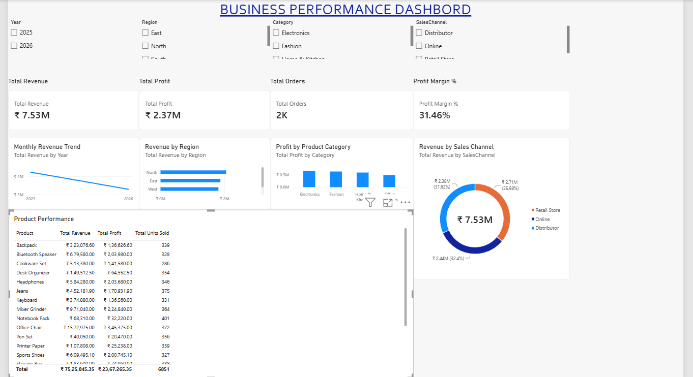

## Dashboard Preview



# 📊 Business Performance Dashboard

An interactive business intelligence dashboard built using Microsoft Power BI to analyze sales performance, revenue, profitability, regional performance, and product categories.

## 📌 Project Overview

This project focuses on transforming sales data into meaningful business insights through interactive visualizations and key performance indicators (KPIs).

The dashboard helps users explore business performance across different regions, product categories, customer segments, and sales channels.

**Note:** This project uses a synthetic dataset created for learning and portfolio demonstration. The figures do not represent actual market transactions.

## 🎯 Project Objectives

- Analyze total revenue and total profit.
- Track order volume and units sold.
- Evaluate overall profit margin.
- Compare revenue across geographical regions.
- Identify product categories contributing to profitability.
- Analyze monthly revenue trends.
- Compare sales channels.
- Explore data using interactive filters.

## 🛠️ Technologies Used

- Microsoft Power BI Desktop
- DAX (Data Analysis Expressions)
- Python
- CSV Dataset
- Git and GitHub

## 📂 Project Structure

```text
business-performance-dashboard/
│
├── data/
│   └── Business_Sales_Data.csv
│
├── generate_data.py
├── Business_Performance_Dashboard.pbix
├── README.md
├── .gitignore
└── dashboard-preview.png